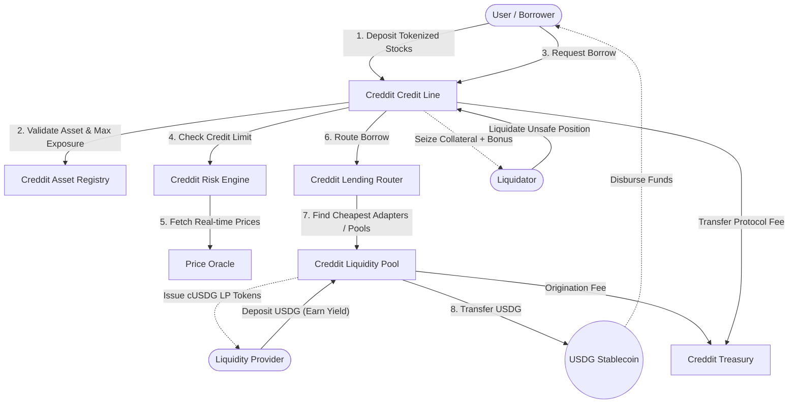

# Creddit Link

**Creddit Link** is a decentralized lending protocol designed to provide programmable asset-backed credit. It allows users to deposit tokenized assets (specifically Real World Assets like tokenized stocks) as collateral to draw a unified, risk-adjusted stablecoin (USDG) credit line — enabling users to unlock liquidity without selling their underlying equity positions.

## Overview

Unlike traditional isolated lending markets, Creddit Link consolidates a user's portfolio into a single, unified financial position. Users can pool different eligible RWAs and draw a revolving credit line against the combined, risk-adjusted value of their assets.

Under the hood, the protocol separates collateral management from liquidity provisioning. Borrow requests are automatically routed across multiple liquidity pools via smart aggregation, picking the cheapest borrow rates available.

### Key Features

- **Unified Credit Line**: Deposit multiple registered Stock Tokens into a single position and draw a single USDG credit line against the combined portfolio value.
- **Smart Lending Router & Capital Aggregation**: The protocol features a lending router that acts as an aggregator over `ILendingAdapter` pools. It quotes available liquidity across all pools and routes borrow requests to the cheapest sources first.
- **ERC-4626 Yield Liquidity Pools**: Liquidity providers (LPs) deposit USDG into yield-bearing `CredditLiquidityPool` vaults (minting `cUSDG` tokens). The liquidity pools mint/disburse USDG to borrowers, collect origination fees for the Treasury, and accrue interest dynamically based on pool utilization.
- **Dynamic Risk Engine**: Credit limits and liquidation thresholds are calculated dynamically based on real-time oracle prices, collateral volatility, and maximum exposure parameters per asset.
- **Revolving Debt Accounting**: A global debt index tracks interest continuously, issuing "debt shares" to borrowers for gas-efficient accounting across the entire protocol.
- **Automated Liquidations**: Anyone can liquidate undercollateralized positions. The system uses dynamic close factors and collateral seizures that reward liquidators while collecting protocol fees for the treasury.
- **Concentration Risk Management**: The protocol enforces maximum exposure caps per asset to ensure the system remains insulated from the idiosyncratic risks of any single stock or asset class.

## Protocol Architecture & Flow

The central entry point is `CredditCreditLine`, which coordinates with `CredditRiskEngine` for solvency and `CredditLendingRouter` for liquidity sourcing across underlying `CredditLiquidityPool` vaults.

## Repository Structure

The project is structured as a **Turborepo** monorepo containing the smart contracts, frontends, and shared packages.

### Smart Contracts (`apps/onchain`)
The core DeFi protocol is written in Solidity and located in `apps/onchain/contracts/core/`.
- `CredditCreditLine.sol`: Main protocol entry point, position manager, and debt index tracker.
- `CredditRiskEngine.sol`: Evaluates portfolio health factors, risk-weighted values, and liquidation thresholds.
- `CredditAssetRegistry.sol`: Configuration registry defining whitelisted RWA collateral assets, LTV ratios, liquidation penalties, and maximum exposure limits.
- `CredditLendingRouter.sol`: Capital aggregator that splits borrow/repay requests across registered `ILendingAdapter` liquidity sources, prioritizing the lowest rates and fees.
- `CredditLiquidityPool.sol`: ERC-4626 vault holding USDG liquidity supplied by LPs. It handles USDG transfers to borrowers, origination fee routing, and interest collection.
- `CredditInterestRateModel.sol`: Kinked interest rate model that calculates borrow APRs based on pool utilization.
- `CredditOracle.sol`: Price feed aggregator ensuring equity collateral and USDG are priced accurately in real-time.
- `CredditTreasury.sol`: Collects and manages protocol fees generated from borrow origination and liquidation events.
- `CredditLens.sol`: Read-only data aggregator providing batch view queries for high-performance frontend interfaces.

### Web Applications (`apps/web` & `apps/docs`)
- Next.js applications serving as the primary user interface and documentation portal for the protocol.

### Packages (`packages/`)
- `@repo/ui`: Shared React component library.
- `@repo/contracts`: TypeScript ABI exports and type definitions for contract interactions.
- `@repo/eslint-config` & `@repo/typescript-config`: Shared linting and TypeScript configurations.
