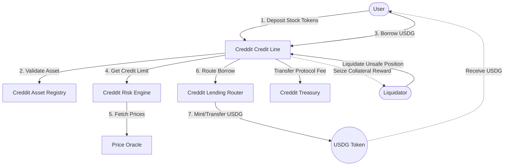

# Creddit Link

**Creddit Link** is a decentralized lending protocol designed to provide programmable asset-backed credit. It allows users to deposit tokenized assets (specifically Real World Assets like tokenized stocks) as collateral to draw a unified, risk-adjusted stablecoin (USDG) credit line. This empowers users to unlock liquidity without having to sell their underlying equity positions.

## Overview

Unlike traditional isolated lending markets, Creddit Link consolidates a user's portfolio into a single, unified financial position. Users can pool different eligible RWAs and draw a revolving USDG credit line against the combined, risk-adjusted value of their assets.

### Key Features

- **Unified Credit Line**: Deposit multiple registered Stock Tokens into a single position and draw a single USDG credit line against the combined portfolio value.
- **Dynamic Risk Engine**: Credit limits and liquidation thresholds are calculated dynamically based on real-time oracle prices, collateral volatility, and maximum exposure parameters per asset.
- **Revolving Debt Accounting**: A global debt index tracks interest continuously, issuing "debt shares" to borrowers. This allows for highly gas-efficient accounting across the entire protocol.
- **Automated Liquidations**: Anyone can liquidate undercollateralized positions. The system uses dynamic close factors and collateral seizures that reward liquidators while collecting protocol fees for the treasury.
- **Concentration Risk Management**: The protocol enforces maximum exposure caps per asset to ensure the system remains insulated from the idiosyncratic risks of any single stock or asset class.

## How It Works (The User Journey)

1. **Deposit:** A user deposits one or more whitelisted tokenized stocks (e.g., tokenized AAPL, NVDA) into a Creddit position. 
2. **Borrow:** The `CredditRiskEngine` evaluates the portfolio and grants a USDG credit limit. The user borrows USDG against this limit. The `CredditLendingRouter` mints/routes the stablecoins to the user.
3. **Repay:** The user can repay their USDG debt at any time to restore their credit limit. Interest accrues globally via the debt index.
4. **Liquidate:** If a user's portfolio value drops significantly, making their position unsafe, liquidators can step in to repay a portion of the debt in exchange for seized collateral plus a liquidation bonus.

## Protocol Architecture & Flow

The central hub of the protocol is the `CredditCreditLine` contract, which orchestrates interactions between the Risk Engine, Asset Registry, and Lending Router.

## Repository Structure

The project is structured as a **Turborepo** monorepo containing the smart contracts, frontends, and shared packages.

### Smart Contracts (`apps/onchain`)
The core DeFi protocol is written in Solidity and located in `apps/onchain/contracts/core/`.
- `CredditCreditLine.sol`: Main protocol entry point and position manager.
- `CredditRiskEngine.sol`: Health factor, credit limit computations, and liquidation logic.
- `CredditAssetRegistry.sol`: Whitelist and configuration (LTV, max exposure) for eligible collateral.
- `CredditLendingRouter.sol`: Manages the minting, burning, and routing of the USDG stablecoin.
- `CredditOracle.sol`: Integrates with external price feeds for real-time asset pricing.
- `CredditTreasury.sol`: Collects and manages protocol fees.
- `CredditLens.sol`: A helper contract for easily querying aggregated on-chain data for the frontend.

### Web Applications (`apps/web` & `apps/docs`)
- Next.js applications serving as the primary user interface and documentation portal for the protocol.

### Packages (`packages/`)
- `@repo/ui`: Shared React component library.
- `@repo/eslint-config` & `@repo/typescript-config`: Shared linting and TypeScript configurations.
